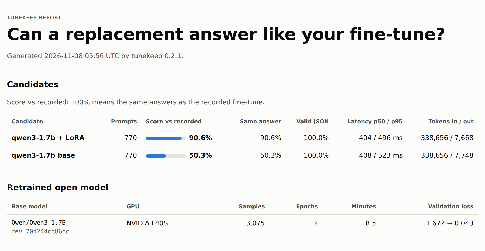

# Proof run: banking77

A public stand-in for a typical OpenAI fine-tune: classify customer messages to an online bank
into one of 77 intents and answer in JSON. It runs the whole tunekeep path on real hardware:
retrain an open model from OpenAI-format data, export it to GGUF, serve it with llama-server, and
score it with `tunekeep compare` and `tunekeep report`.

| Qwen3-1.7B on 770 unseen messages | Accuracy | Valid JSON | Latency p50 / p95 (L4, llama-server) |
|---|---|---|---|
| Base model, given the full list of intents | 50.3% | 100% | 408 / 523 ms |
| After `tunekeep retrain` (LoRA, 3,075 examples) | **90.6%** | 100% | 404 / 496 ms |

Training took 8.5 minutes on one NVIDIA L40S (386 steps, 2 epochs; validation loss 1.67 → 0.043).
The whole run, including the smoke test and scoring, used about $1 of Modal credit.



`results/` holds every scored answer (`compare-*.jsonl`), the training summary and the full
report (`report.html`). Scoring ran the released `tunekeep 0.2.1` from PyPI; the HTML was
re-rendered afterwards with the change that hides empty columns.

## What this shows, and what it doesn't

- **Shows:** the retrain kit turns OpenAI-format training data into a model that serves locally
  and answers in the required JSON format, and the training clearly worked (50% → 91%).
- **"Recorded" here means the human label.** No real OpenAI fine-tune was involved (OpenAI has
  closed fine-tuning to new organisations), so the golden set's answers are banking77's test
  labels. For your own migration, record your fine-tune with `tunekeep record` and compare against that.
- **Not a leaderboard result.** It uses 40 training messages per intent (of about 130) and 10 test
  messages per intent, to keep the run small and cheap.

## Reproduce

```sh
python prepare.py                       # downloads PolyAI's CSVs (pinned by commit and SHA-256)
tunekeep retrain --data data/train.jsonl --validation data/validation.jsonl \
  --epochs 2 --batch-size 16 --grad-accum 1 --gpu L40S --out kit
cd kit && modal run modal_app.py --run banking77-v1 && cd ..
modal run evaluate.py --run banking77-v1
```

`evaluate.py` serves each model with llama-server (official llama.cpp b11980 CUDA build, pinned
by SHA-256) on a Modal L4 and installs `tunekeep==0.2.1` by hash.

## Licences

- Data: [banking77](https://github.com/PolyAI-LDN/task-specific-datasets) by PolyAI, CC BY 4.0
  (Casanueva et al., *Efficient Intent Detection with Dual Sentence Encoders*, 2020).
- Model: [Qwen3-1.7B](https://huggingface.co/Qwen/Qwen3-1.7B), Apache-2.0.
